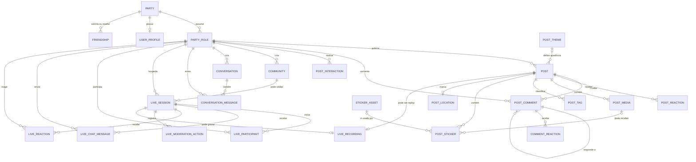

# Modelo de domínio social

Este documento descreve os modelos Dart em `lib/model/`. As relações entre
entidades são representadas por IDs; valores pequenos e pertencentes a um único
objeto, como localização e posição de sticker, são mantidos como objetos de
valor. As classes ainda não definem um contrato de API ou persistência.

## Visão geral dos relacionamentos

`PARTY_ROLE` é a identidade contextual usada como autor ou ator. Seu campo
`scopeId` aponta para a comunidade, conversa ou live indicada por `scope`;
portanto, é uma referência polimórfica e deve ser validada pela camada de
domínio/repositório.

## Identidade e papéis

| Classe | Atributos principais | Responsabilidade |
|---|---|---|
| `Party` | `id`, `type`, `createdAt` | Identidade de pessoa ou organização. |
| `UserProfile` | `partyId`, `platformUserRoleId`, `username`, `displayName`, `avatarUrl?`, `bio?`, `createdAt` | Dados de perfil associados à `Party` e ao papel de usuário da plataforma. |
| `PartyRole` | `id`, `partyId`, `type`, `scope`, `scopeId?`, `validFrom`, `validUntil?` | Papel que uma `Party` exerce em um contexto. |
| `Friendship` | `id`, `requesterPartyId`, `recipientPartyId`, `status`, `requestedAt`, `respondedAt?` | Solicitação e estado da relação de amizade entre duas parties. |

`PartyRole` oferece factories para `platformUser`, papéis de comunidade
(`communityOwner`, `communityModerator`, `communityMember`), participante de
conversa e papéis de live (`liveHost`, `liveModerator`, `liveSpeaker`,
`liveViewer`). `isActiveAt(instant)` considera `validFrom` inclusivo e
`validUntil` exclusivo.

| Enum | Valores |
|---|---|
| `PartyType` | `person`, `organization` |
| `PartyRoleScope` | `platform`, `community`, `conversation`, `liveSession` |
| `FriendshipStatus` | `pending`, `accepted`, `rejected`, `blocked` |

## Publicações

| Classe | Atributos principais | Relações e métodos |
|---|---|---|
| `Post` | `id`, `authorPartyRoleId`, `content`, `title?`, `themeId?`, `location?`, `media`, `stickers`, `tags`, `engagement`, `relationship?`, `visibility`, `status`, `createdAt`, `updatedAt?`, `expiresAt?` | Autor por `PartyRole`; agrega mídias, stickers e tags; `isEphemeral`, `hasTitle`, `hasLocation`, `hasStickers`. |
| `PostContent` | `segments` | Texto formatado; `plainText` concatena o texto dos segmentos. |
| `PostTextSegment` | `text`, `styles`, `entity?` | Trecho com estilos e entidade opcional (menção, hashtag ou link). |
| `PostTextEntity` | `type`, `value`, `id?` | Destino de um trecho especial. |
| `PostMedia` | `id`, `type`, `sourceUrl`, `thumbnailUrl?`, `altText?`, `mimeType?`, `width?`, `height?`, `duration?` | Mídia de imagem, GIF ou vídeo; `isVideo`. |
| `PostTag` | `id`, `label`, `type` | Hashtag, tópico ou usuário marcado. Tópicos editoriais ficam aqui, não em `PostTheme`. |
| `PostRelationship` | `type`, `targetPostId` | Resposta ou citação de outra publicação. |
| `PostComment` | `id`, `postId`, `parentCommentId?`, `authorPartyRoleId`, `content`, `media`, `engagement`, `createdAt` | Pertence a um post e pode responder a outro comentário; `isReply`. |

| Enum | Valores |
|---|---|
| `PostVisibility` | `public`, `followers`, `mentionedUsers`, `private` |
| `PostStatus` | `draft`, `published`, `archived`, `deleted` |
| `PostTextStyle` | `bold`, `italic`, `underline`, `strikethrough`, `code` |
| `PostTextEntityType` | `mention`, `hashtag`, `link` |
| `PostMediaType` | `image`, `gif`, `video` |
| `PostTagType` | `hashtag`, `topic`, `user` |
| `PostRelationshipType` | `reply`, `quote` |

### Tema, localização e stickers

| Classe | Atributos principais | Relação / validação |
|---|---|---|
| `PostTheme` | `id`, `name`, `backgroundColorHex?`, `foregroundColorHex?`, `accentColorHex?`, `backgroundAssetUri?` | Catálogo de aparência visual; `Post.themeId` referencia o tema. |
| `PostLocation` | `name`, `placeId?`, `locality?`, `region?`, `countryCode?`, `precision`, `coordinates?` | Valor opcional dentro de `Post`; pode identificar um local sem coordenadas. |
| `GeoCoordinates` | `latitude`, `longitude` | Valida latitude entre -90 e 90 e longitude entre -180 e 180. |
| `StickerAsset` | `id`, `type`, `assetUri`, `accessibilityLabel?` | Asset reutilizável do catálogo de stickers. |
| `PostSticker` | `id`, `payload`, `position`, `targetMediaId?` | Instância no post; `targetMediaId` vazio significa canvas do post; `isAttachedToMedia`. |
| `PostStickerPosition` | `x`, `y`, `scale`, `rotationDegrees`, `layerOrder` | Coordenadas normalizadas entre 0 e 1; escala positiva; rotação finita. |

Os payloads de `PostSticker` são tipos distintos: `AssetStickerPayload`
(referencia `StickerAsset.id`), `TextStickerPayload` (usa `PostContent`),
`LocationStickerPayload`, `MentionStickerPayload` (referencia `PartyRole`) e
`TagStickerPayload` (referencia `PostTag`). O construtor de `Post` rejeita
stickers que apontem para uma mídia que não pertence ao post.

## Interações com publicações e comentários

| Classe | Atributos principais | Relação / comportamento |
|---|---|---|
| `PostInteraction` | `id`, `actorPartyRoleId`, `createdAt` | Tipo base selado para ações de usuário. |
| `PostReaction` | `postId`, `type`, `removedAt?` | Reação a post; `isActive`. |
| `CommentReaction` | `commentId`, `type`, `removedAt?` | Reação a comentário; `isActive`. |
| `PostSave` | `postId`, `removedAt?` | Salvamento; `isActive`. |
| `PostShare` | `postId`, `destination`, `conversationId?`, `responsePostId?`, `responseMessageId?` | Compartilhamento no feed ou conversa. Resposta pode apontar para post citado ou mensagem resultante. |
| `PostEngagementSummary` | `reactionCount`, `commentCount`, `saveCount`, `shareCount`, `viewCount`, `viewer` | Contadores resumidos; não substituem registros de interação. |
| `CommentEngagementSummary` | `reactionCount`, `replyCount`, `viewerReaction?` | Resumo de engajamento de comentário. |
| `PostViewerEngagement` | `reaction?`, `isSaved`, `isShared` | Estado do usuário atual na resposta/resumo. |

`PostReactionType` inclui `like`, `love`, `laugh`, `wow`, `support`, `sad` e
`angry`. `PostShare.toFeed` pode referenciar `responsePostId`;
`PostShare.toConversation` exige `conversationId` e pode referenciar a mensagem
resultante. `PostShareDestination` define `feed` ou `conversation`.

## Comunidades e conversas

| Classe | Atributos principais | Relações |
|---|---|---|
| `Community` | `id`, `name`, `description?`, `createdByPartyRoleId`, `createdAt`, `visibility` | Criador por papel; membros/moderadores/proprietários são `PartyRole`s no escopo da comunidade. |
| `Conversation` | `id`, `type`, `createdByPartyRoleId`, `createdAt` | Participantes são `PartyRole`s no escopo da conversa. |
| `ConversationMessage` | `id`, `conversationId`, `senderPartyRoleId`, `content`, `media`, `sharedPostId?`, `replyToMessageId?`, `createdAt`, `editedAt?` | Mensagem, resposta ou compartilhamento de post dentro da conversa. |

| Enum | Valores |
|---|---|
| `CommunityVisibility` | `public`, `private`, `hidden` |
| `ConversationType` | `direct`, `group` |

## Lives

| Classe | Atributos principais | Relações |
|---|---|---|
| `LiveSession` | `id`, `hostPartyRoleId`, `communityId?`, `title`, `description?`, `status`, `visibility`, `createdAt`, `scheduledAt?`, `startedAt?`, `endedAt?` | Host por papel; comunidade opcional. |
| `LiveParticipant` | `id`, `liveSessionId`, `partyRoleId`, `joinedAt`, `leftAt?`, `status` | Presença de um papel na sessão; `isConnected`. |
| `LiveChatMessage` | `id`, `liveSessionId`, `authorPartyRoleId`, `replyToMessageId?`, `content`, `createdAt`, `status` | Mensagem ligada à sessão e ao autor. |
| `LiveReaction` | `id`, `liveSessionId`, `actorPartyRoleId`, `targetPartyRoleId?`, `type`, `createdAt` | Reação à live ou direcionada a um participante. |
| `LiveEngagementSummary` | `liveSessionId`, `viewerCount`, `peakViewerCount`, `messageCount`, `reactionCounts` | Contadores agregados; o mapa de reações é imutável. |
| `LiveModerationAction` | `id`, `liveSessionId`, `actorPartyRoleId`, `targetPartyRoleId?`, `targetMessageId?`, `type`, `reason?`, `createdAt`, `expiresAt?` | Ação de moderação e seus alvos. |
| `LiveRecording` | `id`, `liveSessionId`, `status`, `mediaUrl?`, `thumbnailUrl?`, `duration?`, `replayPostId?`, `createdAt`, `readyAt?` | Gravação da sessão; pode apontar para um post de replay. |

`LiveStatus`: `scheduled`, `live`, `ended`, `cancelled`.
`LiveVisibility`: `public`, `followers`, `community`, `private`.
`LiveParticipantStatus`: `connected`, `disconnected`, `left`, `removed`.
`LiveChatMessageStatus`: `visible`, `hidden`, `removed`.
`LiveReactionType`: `heart`, `clap`, `laugh`, `wow`, `fire`, `sad`.
`LiveRecordingStatus`: `processing`, `ready`, `failed`, `unavailable`.

As ações de moderação são `hideMessage`, `removeMessage`, `pinMessage`,
`unpinMessage`, `muteParticipant`, `removeParticipant` e `banParticipant`.
Mensagens e reações são registros separados dos contadores para permitir que a
camada de streaming agregue eventos de alto volume.

## Convenções e limites atuais

- IDs são `String`; unicidade e existência das referências devem ser garantidas
  pelo repositório/serviço que persistir os dados, exceto o `targetMediaId` de
  stickers, validado pelo construtor de `Post`.
- Listas e mapas fornecidos pelos modelos são copiados e expostos como
  imutáveis quando aplicável.
- `PostLocation.coordinates` é opcional; a precisão deve refletir o que o
  usuário escolheu compartilhar.
- `PostEngagementSummary` e `LiveEngagementSummary` são projeções agregadas,
  não fontes de verdade para ações individuais.
- Os modelos não implementam serialização JSON, armazenamento, autorização,
  entrega de mídia ou transporte de live.

## Backend simulado

`SocialDataService` define a fronteira consumida pela interface.
`AssetSocialDataService` carrega `assets/data/social_mock_data.json` e expõe
`SocialMockData`, um snapshot imutável do JSON com consultas comuns para posts,
perfis, comentários, conversas e mensagens de live. O serviço é registrado na
injeção de dependências e disponibilizado por `Provider<SocialDataService>`.

O fixture usa IDs cruzados entre as seções, timestamps ISO-8601 em UTC e enums
serializados pelos nomes Dart. Mídias de imagem JPEG, GIF e vídeo MP4 apontam
para URLs de demonstração e exigem rede para renderização; `duration_seconds`
representa a duração de vídeo em segundos. `schema_version` identifica a versão
do formato do fixture. As seções e chaves estão em
`lib/util/const/app/social_data_constants.dart`.

Hashtags são declaradas na seção `hashtags` com tipo (`user`, `official` ou
`community`), emoji e, para comunidades, o ID da comunidade relacionada. Posts
referenciam hashtags por ID em entidades de texto e tags; a navegação mantém
feeds temporários enquanto abertos e persiste apenas os feeds fixados.

O serviço preserva o formato JSON como DTO de mock; a conversão para modelos de
domínio fica para a camada de mapeamento quando os consumidores da interface
forem definidos.
